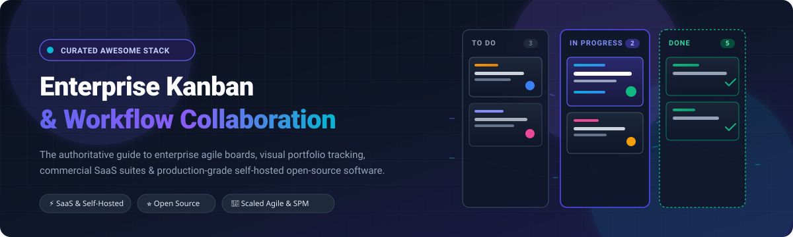

# Awesome Enterprise Kanban Collaboration

  

  <strong>A curated directory of top-tier Enterprise Kanban Collaboration platforms, visual workflow automation systems, commercial SaaS suites, and self-hosted open-source alternatives.</strong>

  
  
  
  

---

## 🧭 Table of Contents

- [Overview &amp; SEO Summary](#-overview--seo-summary)
- [Sector Overview &amp; Market Dynamics](#-sector-overview--market-dynamics)
- [Enterprise SaaS &amp; Commercial Hosted Platforms](#-enterprise-saas--commercial-hosted-platforms)
- [Self-Hosted &amp; Open-Source Software](#-self-hosted--open-source-software)
- [Comprehensive Feature Matrix](#-comprehensive-feature-matrix)
- [Evaluation &amp; Selection Criteria](#-evaluation--selection-criteria)
- [Contributing](#-contributing)
- [License](#-license)

---

## 🔎 Overview &amp; SEO Summary

**Enterprise Kanban Collaboration** software empowers distributed organizations, agile development teams, and cross-functional business units to visualize workflows, enforce Work-in-Progress (WIP) limits, reduce cycle times, and orchestrate complex portfolio-level initiatives. 

Whether your goal is implementing Scaled Agile Framework (SAFe), Lean portfolio management, private sovereign data-residency compliance, or lightweight developer task tracking, choosing between **cloud-hosted SaaS work operating systems** and **deployable open-source Kanban servers** is a critical architectural decision.

### Key Capabilities Evaluated
- **Visual Work Delivery:** Real-time multi-board synchronization, swimlanes, custom card fields, and WIP constraints.
- **Enterprise Governance:** Single Sign-On (SAML/SSO), SCIM user provisioning, audit logging, and role-based access control (RBAC).
- **Scale & Analytics:** Cumulative flow diagrams (CFD), cycle and lead time tracking, Monte Carlo simulations, and cross-team dependency mapping.
- **Data Sovereignty:** Self-hosted on-premises deployment, air-gapped support, Docker/Kubernetes orchestration, and open-source licensing.

---

## 📈 Sector Overview &amp; Market Dynamics

The global collaborative work management and enterprise project portfolio management (PPM) software market is estimated at **$8.0B to $8.8B in 2024** and is projected to expand to **$10.2B+ by 2025**, expanding at a robust ~12–14% CAGR fueled by distributed hybrid workplaces and AI-driven automation. 

The sector exhibits a **moderately fragmented** overall structure: while hyperscale enterprise incumbents (like Microsoft and Atlassian) concentrate developer and desktop workflow segments, a vigorous influx of specialized work operating systems, lean portfolio engines, and privacy-first open-source self-hosted alternatives maintain competitive diversity across specialized verticals.

---

## 🟦 Enterprise SaaS &amp; Commercial Hosted Platforms

The table below lists leading commercial enterprise Kanban and work management platforms, sorted descending by company size (market valuation or parent revenue):

| Platform | Starting Tier Price | Free Tier / Trial Limit | Company Scale (Valuation / Revenue) | Deployment &amp; Ecosystem | Core Enterprise Focus |
|:---|:---|:---|:---|:---|:---|
| **[Targetprocess](https://www.targetprocess.com/)** | $12.00 / user / mo (starting commercial tier) | 30-Day Free Trial (Full enterprise access upon request; no user or entity cap during trial) | **$215B+** (Acquired by Apptio for $4.6B, subsidiary of IBM) | Managed Cloud SaaS | Enterprise Agile Planning (EAP), SAFe, and Strategic Portfolio Management (SPM) |
| **[Trello Enterprise](https://trello.com/enterprise)** | $5.00 / user / mo (Standard; Enterprise at $17.50 / user / mo) | Free-for-ever tier (Up to 10 workspace boards, unlimited cards, 10MB file limit) | **~$35B** (Atlassian public parent company, NASDAQ: TEAM) | Atlassian Cloud | Pioneer visual Kanban board with Atlassian Admin Key and multi-workspace governance |
| **[Smartsheet](https://www.smartsheet.com/)** | $9.00 / user / mo (Pro tier, billed annually) | 30-Day Free Trial (Up to 1 seat, 2 sheets, limited automation runs) | **$8.4B** (Acquired / Take-private valuation by Blackstone &amp; Vista Equity) | Managed Cloud SaaS | Dynamic spreadsheet-to-card/Kanban mapping, executive rollups, and governance |
| **[Monday.com](https://monday.com/)** | $9.00 / seat / mo (Basic tier, min 3 seats billed annually) | Free-for-ever tier (Up to 2 seats, 3 boards, 200+ templates, 500MB storage) | **~$8.0B** (Public, NASDAQ: MNDY; $1.0B+ ARR) | Multi-tenant SaaS | Modular Work OS with no-code board automations, dashboards, and Kanban views |
| **[Asana Enterprise](https://asana.com/)** | $10.99 / user / mo (Starter tier, billed annually) | Free-for-ever tier (Up to 10 users, unlimited tasks/projects, list/board/calendar views) | **~$3.0B** (Public, NYSE: ASAN; $700M+ ARR) | Multi-tenant SaaS | Cross-functional work graph, visual Kanban boards, and organizational goal alignment |
| **[Planview AgilePlace](https://www.planview.com/products-solutions/products/agileplace/)** | $19.00 / user / mo (Standard tier; Enterprise custom-quoted) | 30-Day Free Trial (Full platform capabilities, up to 10 trial users, no credit card required) | **$1.6B+** (Valuation backed by TPG Capital &amp; TA Associates; ~$500M annual revenue) | Enterprise Cloud | Scaled enterprise Kanban, LeanKit heritage, value stream management, and portfolio flow |
| **[ClickUp](https://clickup.com/)** | $7.00 / user / mo (Unlimited tier, billed annually) | Free-for-ever tier (Unlimited members, 100MB storage, unlimited tasks, 100 Kanban views) | **$4.0B** (Series C valuation; ~$200M ARR) | Multi-tenant SaaS | All-in-one productivity suite with customizable Kanban, docs, goals, and time tracking |
| **[Wrike](https://www.wrike.com/)** | $9.80 / user / mo (Team tier, billed annually) | Free-for-ever tier (Unlimited users, 2GB storage, web/desktop/mobile apps, subtask management) | **~$2.25B** (Acquired valuation by Symphony Technology Group; ~$200M ARR) | Enterprise Cloud SaaS | Enterprise work management, custom request forms, interactive Kanban, and Gantt charts |
| **[Kanbanize (Businessmap)](https://businessmap.io/)** | $8.50 / user / mo (Team tier billed annually, starting 15 users) | 30-Day Free Trial (Full feature access, unlimited boards/cards, guided onboarding) | **~$100M** (Growth-stage venture backed, bootstrapped leader; ~$15M+ ARR) | SaaS / Dedicated Cloud | Specialized portfolio Kanban, multi-tier card hierarchies, cycle time, and Monte Carlo analytics |
| **[SwiftKanban](https://www.nimblework.com/swiftkanban/)** | $7.00 / user / mo (Group tier; Enterprise at $15.00 / user / mo) | Free-for-ever tier (Up to 3 users, 2 boards, 5 custom card types, standard metrics) | **Private / Bootstrapped** (NimbleWork Inc., established global mid-market enterprise vendor) | Cloud / Hybrid SaaS | Formal Lean-Kanban execution, Scrumban, CFD analytics, and enterprise WIP limit controls |

---

## 🟩 Self-Hosted &amp; Open-Source Software

The table below catalogs premier open-source and self-hostable Kanban platforms. Each project includes a GitHub social badge indicating its real-time star popularity, sorted descending by GitHub star count:

| Software | Stars &amp; Community | Tech Stack | License | Real-time | Key Highlights |
|:---|:---|:---|:---|:---:|:---|
| **[NocoDB](https://github.com/nocodb/nocodb)** |  | TypeScript / Vue.js / Node.js | AGPL-3.0 | ✅ | Open-source Airtable alternative that turns any relational database (PostgreSQL, MySQL, SQLite) into smart Kanban boards, grids, and galleries. |
| **[Plane](https://github.com/makeplane/plane)** |  | Next.js / Python (Django) / PostgreSQL | AGPL-3.0 | ✅ | Modern, open-source Jira &amp; Linear alternative featuring real-time Kanban boards, sprint cycles, issue triage, and MCP AI server integrations. |
| **[Focalboard](https://github.com/mattermost-community/focalboard)** |  | Go / TypeScript / React | MIT / Apache-2.0 | ✅ | Open-source, multilingual Trello and Notion alternative built by Mattermost. Standalone desktop or server deployment with Kanban boards, cards, and properties. |
| **[WeKan](https://github.com/wekan/wekan)** |  | Meteor / Node.js / MongoDB (or FerretDB) | MIT | ✅ | The classic and closest open-source Trello clone. Built-in swimlanes, WIP limits, card voting, subtasks, and LDAP/SAML enterprise authentication. |
| **[Planka](https://github.com/plankanban/planka)** |  | React / Node.js / PostgreSQL | Fair-code / Pro | ✅ | Polished, elegant real-time Kanban board with instant WebSocket synchronization, OIDC SSO, Apprise notifications, and Docker deployment. |
| **[Leantime](https://github.com/Leantime/leantime)** |  | PHP / JavaScript / MySQL | AGPL-3.0 | ✅ | Strategic agile project management system designed with ADHD and cognitive accessibility in mind. Combines Kanban, Lean canvas, milestones, and time tracking. |
| **[Kanboard](https://github.com/kanboard/kanboard)** |  | PHP / SQLite / PostgreSQL / MySQL | MIT | ❌ | Deliberately minimal, hyper-focused Kanban tool honoring classic WIP limits, visual column thresholds, swimlanes, subtasks, and low-overhead maintenance. |
| **[Vikunja](https://github.com/go-vikunja/vikunja)** |  | Go / Vue.js / SQLite or PostgreSQL | AGPL-3.0 | ✅ | Lightweight, high-performance to-do and project management engine featuring Kanban boards, Gantt charts, subtasks, relations, and CalDAV synchronization. |
| **[Kan.bn](https://github.com/kanbn/kan)** |  | Next.js / TypeScript / PostgreSQL | AGPL-3.0 | ✅ | Modern open-source Trello alternative built with Next.js, tRPC, and Drizzle. Features one-click Trello migration, AI MCP agent tools, and unlimited cards. |
| **[Nullboard](https://github.com/apankrat/nullboard)** |  | Pure Vanilla JavaScript / HTML5 | BSD-2-Clause | ❌ | Single-page, zero-dependency, ultra-minimalist Kanban board. Runs completely locally inside the browser with optional local backup agent daemon. |
| **[Worklenz](https://github.com/Worklenz/worklenz)** |  | React / Node.js / PostgreSQL | AGPL-3.0 | ✅ | Full-scale project management platform combining extended Kanban boards, time tracking, custom fields, dark mode, and resource capacity planning. |
| **[Taiga](https://github.com/taigaio/taiga-docker)** |  | Python / Django / AngularJS / Docker | AGPL-3.0 | ✅ | Agile visual platform designed for multi-functional agile teams. Deep Kanban board customizability paired with Scrum backlogs, epics, and issue trackers. |
| **[Nextcloud Deck](https://github.com/nextcloud/deck)** |  | PHP / Nextcloud Hub | AGPL-3.0 | ✅ | Integrated Kanban app for Nextcloud private clouds. Link cards directly to private cloud files, share boards with Circle groups, and sync calendar deadlines. |
| **[Werkyn](https://github.com/rackstead/werkyn)** |  | React / Fastify / TypeScript / PostgreSQL | AGPL-3.0 | ✅ | Developer-preview project management workspace integrating real-time Kanban boards with documentation wikis, task dependencies, and command palettes. |

---

## 📊 Comprehensive Feature Matrix

| Solution | Deployment | License | WIP Limits | Swimlanes | Portfolio / Scaled Agile | SSO / SAML | Real-time Sync |
|:---|:---:|:---:|:---:|:---:|:---:|:---:|:---:|
| **Targetprocess** | Cloud SaaS | Commercial | ✅ | ✅ | ✅ (SAFe / LeSS) | ✅ | ✅ |
| **Trello Enterprise** | Cloud SaaS | Commercial | 🟡 (Power-Up) | ❌ | 🟡 (Workspace Views) | ✅ | ✅ |
| **Smartsheet** | Cloud SaaS | Commercial | ❌ | 🟡 (Groupings) | ✅ | ✅ | ✅ |
| **Monday.com** | Cloud SaaS | Commercial | ❌ | 🟡 (Sub-items) | ✅ | ✅ | ✅ |
| **Asana Enterprise** | Cloud SaaS | Commercial | ❌ | 🟡 (Sections) | ✅ (Portfolios) | ✅ | ✅ |
| **Planview AgilePlace** | Cloud SaaS | Commercial | ✅ | ✅ | ✅ (Full SPM) | ✅ | ✅ |
| **ClickUp** | Cloud SaaS | Commercial | ✅ (ClickApp) | 🟡 (Status Grouping)| ✅ | ✅ | ✅ |
| **Wrike** | Cloud SaaS | Commercial | 🟡 (Custom Rules) | 🟡 | ✅ | ✅ | ✅ |
| **Kanbanize (Businessmap)**| Cloud SaaS | Commercial | ✅ | ✅ | ✅ (Multi-tiered) | ✅ | ✅ |
| **SwiftKanban** | Cloud / On-Prem | Commercial | ✅ | ✅ | ✅ (Portfolio Kanban) | ✅ | ✅ |
| **Plane** | Self-Hosted / Cloud| AGPL-3.0 | ✅ | ✅ | ✅ (Cycles &amp; Modules)| ✅ (Pro) | ✅ |
| **Focalboard** | Self-Hosted / Desktop | MIT / Apache-2.0 | ❌ | ❌ | 🟡 | ✅ (via Mattermost)| ✅ |
| **WeKan** | Self-Hosted | MIT | ✅ | ✅ | 🟡 (Subtasks) | ✅ (LDAP/OIDC/SAML)| ✅ |
| **Planka** | Self-Hosted | Fair-code | ❌ | ❌ | ❌ | ✅ (OIDC / Pro SAML)| ✅ |
| **Leantime** | Self-Hosted / Cloud| AGPL-3.0 | 🟡 | 🟡 | ✅ (Lean Canvas) | ✅ (Enterprise) | ✅ |
| **Kanboard** | Self-Hosted | MIT | ✅ | ✅ | ❌ | ✅ (LDAP/Reverse Proxy)| ❌ |
| **Vikunja** | Self-Hosted / Cloud| AGPLv3 | ❌ | ❌ | ❌ | ✅ (OpenID) | ✅ |
| **Nextcloud Deck** | Self-Hosted | AGPL-3.0 | ❌ | ❌ | ❌ | ✅ (Nextcloud Core) | ✅ |

---

## 🎯 Evaluation &amp; Selection Criteria

When selecting an enterprise Kanban system, enterprise architecture teams should review the following technical factors:

1. **WIP Limit Strictness:** Do teams need strict WIP enforcement (e.g., *Kanbanize*, *SwiftKanban*, *Kanboard*, *AgilePlace*) that prevents adding tasks when limits are exceeded, or advisory highlighting?
2. **Data Residency & Air-Gapped Environments:** Organizations in regulated defense, healthcare, or financial sectors frequently require completely air-gapped self-hosted deployments (*WeKan*, *Kanboard*, *Plane*, *Planka*).
3. **Hierarchy & Multi-Tier Portfolio Boards:** Frontline task boards must often aggregate into program and strategic initiative levels (*Targetprocess*, *Kanbanize*, *Planview AgilePlace*).
4. **Extensibility & Agentic Automation:** Modern software teams increasingly favor open APIs and Model Context Protocol (MCP) support (*Kan.bn*, *Plane*) to enable autonomous AI agents to manage board states.

---

## 🤝 Contributing

Contributions are warmly welcomed! If you are maintaining or using an open-source Kanban platform or enterprise tool that should be included:

1. Fork this repository.
2. Create a descriptive feature branch (`git checkout -b add-my-kanban-tool`).
3. Ensure the project is actively maintained (active commits/releases within the past 12 months) with genuine open-source licensing.
4. Submit a Pull Request detailing the stack, license, and architectural highlights.

---

## 📄 License

This compilation is licensed under the [Creative Commons Zero v1.0 Universal (CC0 1.0)](LICENSE) Public Domain Dedication. Listed commercial products and open-source software packages retain their respective trademarks, copyrights, and software licenses.